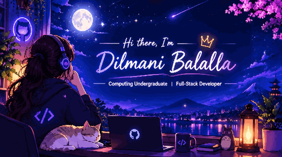

```html
<p align="center">
  
</p>
```
I'm a software developer passionate about building web and mobile applications, exploring new technologies, and solving real-world problems through code.

- 🔭 **I'm currently working on:** SLSEA SolarWatch, a solar performance monitoring and investigation platform, and exploring new ideas through personal projects.
- 🌱 **I'm currently learning:** DevOps, cloud technologies, CI/CD pipelines, containerisation, and deployment practices.
- 👯 **I'm looking to collaborate on:** Full-stack applications, open-source projects, backend development, and innovative software solutions.
- 🤔 **I'm looking for help with:** Exploring better software architecture practices, scalable applications, and DevOps workflows.
- 💬 **Ask me about:** Java, Spring Boot, React, Next.js, TypeScript, Node.js, REST APIs, databases, and SwiftUI.
- 📫 **How to reach me:** [LinkedIn](https://www.linkedin.com/in/dilmani-balalla-05a753356/) | [Email](mailto:dilmanibalalla@gmail.com)
- ⚡ **Fun fact:** I enjoy learning completely new technologies and turning ideas into working applications. BorrowBuddy was my first hands-on journey into iOS development!

### 💻 Technologies & Tools

**Languages:** Java · JavaScript · TypeScript · Swift · Python

**Frontend:** React · Next.js · Redux · Tailwind CSS · HTML · CSS

**Backend:** Spring Boot · Node.js · Express.js · REST APIs

**Databases:** PostgreSQL · MongoDB · MySQL · Firebase

**Tools & Platforms:** Git · GitHub · Jira · AWS S3 · Keycloak · Storybook

### 🚀 Projects & Experience

- **BorrowBuddy:** Independently developed an iOS community tool-lending application using SwiftUI and Firebase.
- **SLSEA SolarWatch:** Developing a solar performance monitoring and investigation platform.
- **House of Cosmic Wonders:** Contributed to a jewellery and gemstone e-commerce platform during my software development internship.
- **Charge99:** Contributed to an EV charging station management platform during my software development internship.

---

✨ *Building, learning, experimenting, and getting better with every commit!*
